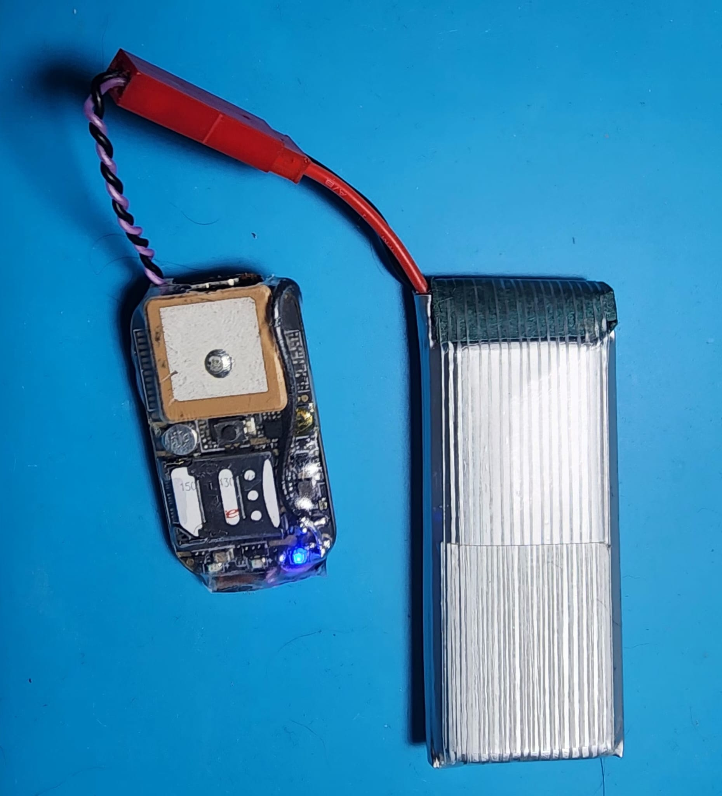
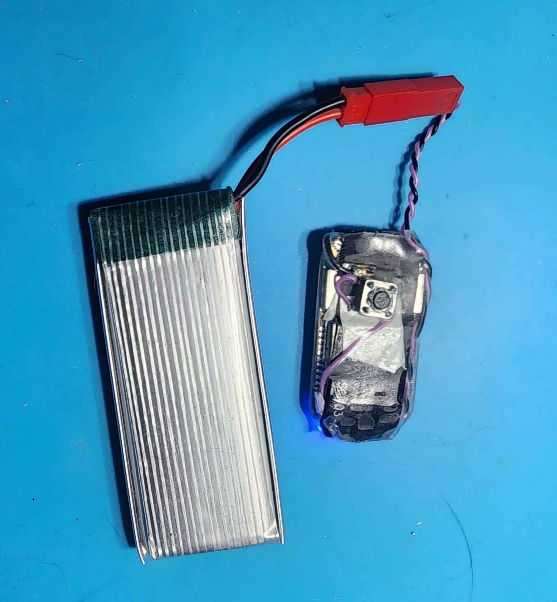
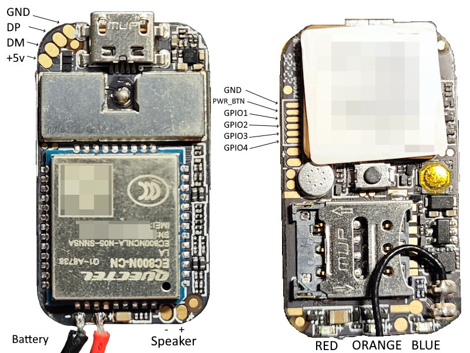
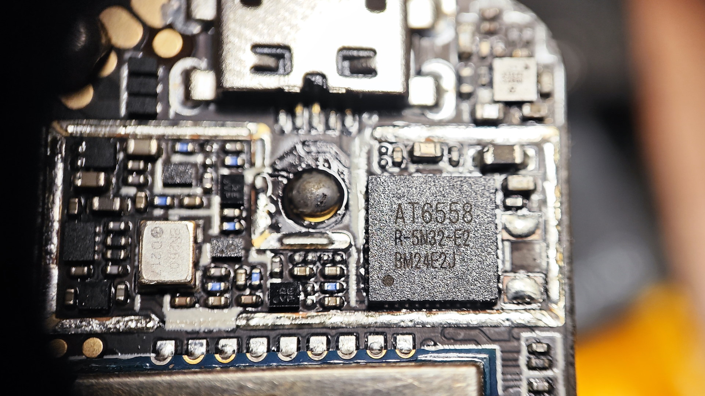
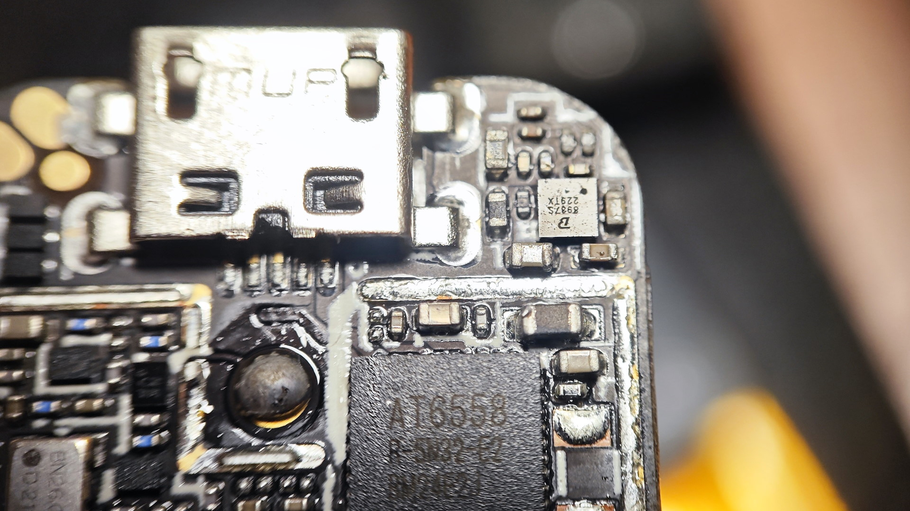
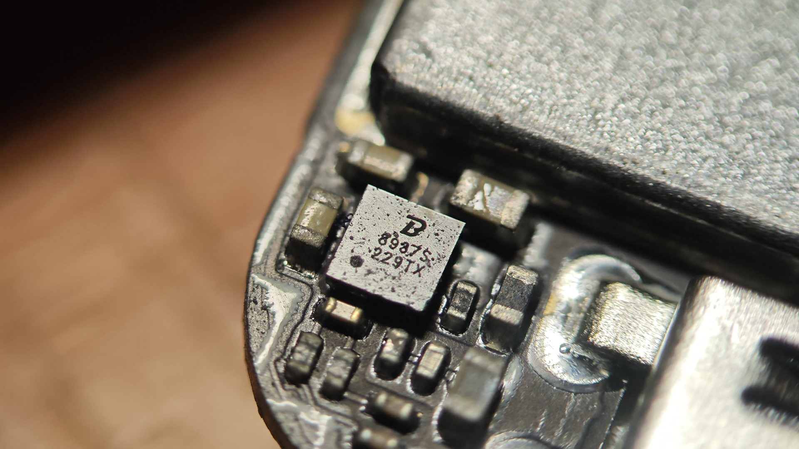

# ZX980 — ZX908 / Quectel EC800M GPS tracker

QuecPython firmware for the **ZX908** tracker box fitted with a **Quectel EC800M-CNLE** 4G module. At startup, the tracker reads its GPS position and sends it over HTTP to a server. The server stores the positions and shows them on a map: see [`ZX980_Server`](../ZX980_Server).

This project is adapted from [FoxExe/ZX908](https://github.com/FoxExe/ZX908), originally written for the EC800N.



## How it works

1. At startup, `main.py` runs `gps_post.py` in a thread, so the QPYcom REPL stays usable.
2. The script waits for the 4G connection (Free APN `free`), powers on the GPS and reads the NMEA sentences.
3. When the GPS has a position, it sends to the server:
   - **every 10 s**, a short line: the position;
   - **every 60 s**, a full line: the position plus the device and network status.
4. The LEDs show the status: 🟡 yellow for the GPS, 🔴 red for each message sent.
5. If the script crashes, it restarts after 10 s.

### Messages sent

Request `POST http://<server_host>:<server_port><server_path>` (set in [`usr/config.json`](usr/config.json)), with the JSON body `{"texte": "<CSV line>"}`.

**Short line (every 3 s by default, `gps_interval_s` in `config.json`), 5 fields:**

```
datefrance,posX,posY,altitude,vitesse,
16/10/2026 19:40:39,0°13'36.00"E,49°08'48.00"N,45.2m,0.0km/h,
```

**Full line (every 60 s by default, `full_interval_s` in `config.json`, instead of the short line), 12 fields:**

```
datefrance,niveaubat,fix2Dou3D,posX,posY,altitude,vitesse,IP,operator,signal,telephone,satellites,
16/10/2026 19:40:39,100%(4165mV),3D,0°13'36.00"E,49°08'48.00"N,45.2m,0.0km/h,10.126.248.157,Free,4G -78dBm,+33600000000,7/12(BD4+GP8),
```

| Field | Source | Details |
|---|---|---|
| `datefrance` | GPS (RMC) | UTC time converted to Paris time, including the summer/winter time change |
| `niveaubat` | `Power.getVbatt()` | Percentage computed from the voltage, followed by the measured voltage: `100%(4165mV)`. Average of 5 readings. About 100 % while USB is plugged in |
| `fix2Dou3D` | GPS (GSA) | `2D`, `3D`, or `?` if unknown |
| `posX` / `posY` | GPS (RMC) | Longitude then latitude, in degrees, minutes and seconds, to 0.01" (about 30 cm) |
| `altitude` | GPS (GGA) | In metres |
| `vitesse` | GPS (RMC) | Speed in km/h |
| `IP` | `dataCall.getInfo()` | Mobile IP address (private, behind Free's CGNAT) |
| `operator` | `net.operatorName()` | Operator name |
| `signal` | `net.getNetMode()`, `net.getSignal()` | Technology (`4G`/`3G`/`2G`) and RSSI in dBm |
| `telephone` | `sim.getPhoneNumber()` | Number stored on the SIM card |
| `satellites` | GPS (GGA, GSV) | `used/in view(details)`. Example: `7/12(BD4+GP8)` = 7 satellites used for the fix, 12 in view, of which 4 BeiDou (`BD`) and 8 GPS (`GP`). `GL` = GLONASS, `GA` = Galileo |

Nothing is sent until the GPS has a **precise** position: 3D fix, HDOP ≤ 2.5 and at least 6 satellites used (`MIN_FIX_TYPE`, `MAX_HDOP`, `MIN_SATS_USED`). Otherwise the REPL prints `Imprecise position (HDOP 3.1 > 2.5), nothing sent`. Indoors or with the antenna badly placed, the tracker can therefore stay silent: relax these thresholds if needed. Data usage with the default intervals (3 s / 60 s): about 32 MB per day, i.e. about 1 GB per month when running continuously (about 600 MB at 5 s, 300 MB at 10 s). At 3 s, a send on a weak 4G signal can take longer than the interval, so the actual interval can be 3 to 4 s, and the 4G radio never goes idle, which shortens battery life. Each message costs about 1.1 KB, because it includes a DNS lookup and a full TCP connection, whereas the CSV line itself is only about 75 bytes.

### Position coherence check

The GPS gives a position every second. Each one is compared with the last **accepted** position, and only accepted positions are sent. The thresholds depend on the `profile` set in `config.json`:

| Check | Rejected when | `walk` (default) | `car` |
|---|---|---|---|
| Jump | Implied speed between the two positions above `MAX_SPEED_KMH`, always checked, even after a long gap | 30 km/h | 250 km/h |
| Distance vs reported speed | Distance moved > reported speed × time + `JUMP_BASE_M` + `JUMP_HDOP_M` per HDOP unit | 10 m + 4 m/HDOP | 15 m + 5 m/HDOP |
| Acceleration | Reported speed changes by more than `MAX_ACCEL_MS2` per second | 3 m/s² | 8 m/s² |
| Time | GPS time going back. The same second twice (duplicate sentence) is ignored silently | | |

- After a gap of more than 30 s (`GAP_S`: tunnel, lost fix), only the jump check applies, so the tracker resumes where it really is.
- After 5 rejections in a row (`RESET_AFTER_REJECTS`), the reference itself was probably the bad point: the tracker restarts from the current position.
- **Stopped** is detected from the positions, not from the GPS speed (too noisy when walking slowly): the points of the last 10 s (`STOP_WINDOW_S`) all lie within 4 m (`STOP_RADIUS_M`) of their centre and the first and last are less than 4 m apart. The position sent is then their centre and the speed is 0. This removes the jitter of a few metres that otherwise draws a "star" on the map. A slow walk (0.5 m/s = 5 m in 10 s) is still seen as moving, so its distance is counted on the dashboard.
- **Moving**: the position sent is the average of the last 3 points (`SMOOTH_N`), about 1 m behind when walking, which removes most of the GPS zigzag. The speed sent is the one measured by the GPS.
- **Altitude**: if it changes faster than 25 m + 10 m/s (`ALT_BASE_M`, `MAX_CLIMB_MS`), the previous altitude is kept (the position is still accepted).
- If positions keep being rejected for more than 5 s (`FIX_TIMEOUT_MS`), nothing is sent rather than an old position.
- Each rejection is printed in the REPL, e.g. `GPS position rejected (1/5): 180 m moved, 1 m expected at 4.0 km/h`.

### LEDs

| LED | GPIO | Behaviour |
|---|---|---|
| 🟡 Yellow (orange on the board) | GPIO17 | Blinks (4 Hz) when the GPS has a position, off otherwise |
| 🔴 Red | GPIO15 | 3 quick flashes for each message accepted by the server (HTTP 2xx), 6 for an SOS |
| 🔵 Blue | GPIO16 | Button feedback only |

**Button feedback** (1 or 2 clicks), on the three LEDs at once, while the send is in progress (at least 1 s; for an SOS, until the server accepts it):

| LED | Pattern |
|---|---|
| 🔴 Red | Fast blink, 50 ms on / 50 ms off |
| 🟡 Yellow | Fast blink, 60 ms on / 60 ms off |
| 🔵 Blue | 2 quick flashes, 1 quick flash, then 0.5 s off, repeated |

Then the red LED shows the 3 (send) or 6 (SOS) "accepted" flashes. All three LEDs are driven by one thread (`led_thread`) so they never conflict.

### Button

The button on the back is the module's power key (PWRKEY), read with `misc.PowerKey` (found with `button_test.py`: it is not wired to any GPIO).

| Clicks | Action |
|---|---|
| 1 click | Sends `MANUAL,` + the full line right away, if the GPS has a fix (quality filter skipped: explicit request). Shown with a pink tag on the dashboard |
| 2 quick clicks (within 0.5 s) | **SOS**: sends `SOS,` + the full line, even without a GPS fix (position `?`, date from the module clock). Retried every 10 s until the server accepts it. Shown in red on the dashboard |

A single click is confirmed only 0.5 s after release (to tell it from a double click). A press of about 10 s powers the board off in hardware: do not hold it that long. Settings: `DOUBLE_PRESS_MS`, `SOS_RETRY_MS`, `FEEDBACK_*`, `BLUE_*` at the top of `gps_post.py`.

## Contents of the `usr/` folder

Copy the whole folder to `/usr` on the module.

### Main program

| File | Role |
|---|---|
| `main.py` | Runs automatically at startup: runs `gps_post.run()` in a thread and restarts it if it crashes |
| `gps_post.py` | Reads the GPS, builds the CSV lines, sends them periodically, drives the LEDs |
| `post_message.py` | `post_json()`: HTTP POST of a JSON body, adapted to QuecPython's quirks. `load_config()`: reads `config.json` |
| `config.json` | API server address and send intervals (see below) |

### Server address and send intervals: `config.json`

```json
{
	"server_host": "totobsd.frouteos.fr",
	"server_port": 8080,
	"server_path": "/message",
	"gps_interval_s": 3,
	"full_interval_s": 60,
	"profile": "walk"
}
```

| Key | Default | Role |
|---|---|---|
| `server_host`, `server_port`, `server_path` | — | API server address |
| `gps_interval_s` | `3` | Short line (GPS position) every N seconds |
| `full_interval_s` | `60` | Full line every N seconds (replaces the short line at that moment) |
| `profile` | `walk` | GPS coherence thresholds: `walk` (pedestrian) or `car`, see "Position coherence check" |

`main.py`, `gps_post.py` and `post_message.py` read this file. To change server or intervals, edit `/usr/config.json` on the module and restart: the code does not change. If the file is missing or invalid, the script prints a message and uses the defaults of `post_message.py`; an invalid interval falls back to its default, and intervals are at least 1 s. At startup, `main.py` prints the address in use (`Server: ...`).

### Other settings (top of `gps_post.py`)

| Constant | Default | Role |
|---|---|---|
| `SENT_BLINKS` | `3` | Number of red flashes per message sent |
| `FIX_BLINK_MS` | `125` | Yellow LED blink speed |
| `FIX_TIMEOUT_MS` | `5000` | Time without a valid RMC sentence after which the position is considered lost |
| `MIN_FIX_TYPE` | `3` | Minimum fix type to send a position (`3` = 3D only, `2` = also 2D) |
| `MAX_HDOP` | `2.5` | Maximum HDOP (horizontal dilution of precision) to send a position |
| `MIN_SATS_USED` | `6` | Minimum number of satellites used in the fix |
| `GNSS_MODE` | `7` | Constellations sent to the GPS chip with `$PCAS04`: 1 GPS, 2 BeiDou, 4 GLONASS, added together (7 = all three) |
| `PROFILES`, `GAP_S`, `RESET_AFTER_REJECTS`, `ALT_BASE_M`, `MAX_CLIMB_MS`, `STOP_WINDOW_S`, `STOP_RADIUS_M`, `SMOOTH_N` | see above | Position coherence check (`MAX_SPEED_KMH`, `MAX_ACCEL_MS2`, `JUMP_BASE_M`, `JUMP_HDOP_M` come from the profile) |
| `LOW_BATTERY_MV` | `3500` | Low battery shutdown threshold (mV) |
| `LOW_BATTERY_CHECKS` | `3` | Number of consecutive low readings before shutdown |
| `BATTERY_CHECK_MS` | `30000` | Interval between two battery checks |

### Test and diagnostic scripts

Run each script from the QPYcom REPL with:

```python
exec(open('/usr/<script>.py').read())
```

During GPS tests, rename `main.py`, otherwise `gps_post` uses the GPS at the same time.

| Script | Role |
|---|---|
| `button_test.py` | Finds how the button is wired: `misc.PowerKey` events, then every free GPIO read as an input |
| `check_ec800m.py` | Checks the model, firmware and QuecPython modules, lights the 3 LEDs and tests NMEA reception |
| `device_info.py` | Prints everything the module can report: module, battery, SIM, network, cells, Wi-Fi, satellites |
| `scan_wifi_gps.py` | Wi-Fi scan (MAC + RSSI), then continuous display of the NMEA sentences |
| `sms_ping.py` | Sets the `free` APN, tries an SMS, then pings google.com (number to set in `PHONE`) |
| `test_GNSS.py`, `test_UART.py`, `test_gpio.py` | GPS, UART and GPIO tests (original FoxExe scripts) |
| `i2c_scanner.py`, `i2c_test.py` | I2C0 bus scan and read (unknown chips at addresses 0x62 and 0xE2) |
| `inspect_all.py`, `test_fullinfo.py` | Inventory of the firmware's modules and information (original FoxExe scripts) |

## Installation

1. **Firmware:** flash [`Firmware/QPY_OCPU_V0005_EC800M_CNLE_FW.bin`](Firmware/QPY_OCPU_V0005_EC800M_CNLE_FW.bin) with [QPYcom](https://python.quectel.com/en/wp-content/uploads/sites/2/2024/11/QPYcom_V3.6.0.zip). Install the [Quectel USB drivers](https://python.quectel.com/wp-content/uploads/2024/09/Quectel_Windows_USB_DriverA_Customer_V1.1.13.zip) first.
2. **Code:** set the server address in `usr/config.json`, then copy the whole content of `usr/` (including `config.json`) to `/usr` on the module, from the File tab of QPYcom.
3. **Check:** run `check_ec800m.py` from the REPL.
4. **Start:** restart the module. Sending starts as soon as 4G is connected and the GPS has a position.

To disable the automatic start, delete or rename `/usr/main.py`.

`Firmware/Tracker_fw_alpha.bin` is FoxExe's original full firmware for the **EC800N**. Do not flash it on an EC800M.

## Hardware

| Item | Value |
|---|---|
| Module | Quectel EC800M-CNLE (LTE Cat 1) |
| Firmware | `QPY_OCPU_V0005_EC800M_CNLE_FW`: QuecPython V0005, MicroPython 1.13, about 950 KB of free RAM, about 540 KB free in `/usr` |
| GPS | AT6558R (CASIC), GPS + BeiDou + GLONASS (set at each power-on), UART2 at 9600 baud ([datasheet](docs/at6558.pdf)) |
| GPS antenna | Passive ceramic. The chip always reports `ANTENNA OPEN`, which is normal. |
| Battery | 1S LiPo with JST connector |
| Tested operator | Free Mobile, APN `free` |

The power button is wired to a dedicated circuit: a short press turns the device on, a long press (more than 10 s) turns it off. The reset button cuts the power.

### Pinout

The EC800M pinout is **identical to the EC800N** for all the pins used. Only the firmware changes.

| GPIO | Pin | Functions | Use on the ZX908 |
|---|---|---|---|
| GPIO1 to 4 | 30 to 33 | PCM / SPI0 | Side port no. 3 to 6 |
| GPIO10 | 54 | CAM_MCLK | GPS power |
| GPIO15 | 80 | CAM_SPI_CLK | Red LED |
| GPIO16 | 81 | CAM_PWDN | Blue LED |
| GPIO17 | 76 | KP_MKOUT_2 | Yellow (orange) LED |
| GPIO23 / 24 | 66 / 67 | I2C0 SDA / SCL | Unknown chips at 0x62 and 0xE2 |
| GPIO25 / 26 | 17 / 18 | UART2 RX / TX | GPS TX / RX |
| GPIO32 / 33 | 28 / 29 | UART1 RX / TX | Auxiliary UART |
| GPIO34 / 35 | 38 / 39 | UART0 RX / TX | Debug UART |
| GPIO36 | 16 | NET_STATUS / PWM2 | — |

Sources: QuecPython documentation for [machine.Pin](https://developer.quectel.com/doc/quecpython/API_reference/en/peripherals/machine.Pin.html), [machine.UART](https://developer.quectel.com/doc/quecpython/API_reference/en/peripherals/machine.UART.html) and [machine.I2C](https://developer.quectel.com/doc/quecpython/API_reference/en/peripherals/machine.I2C.html).

## Photos

| | |
|---|---|
|  |  |
| Back side (button, blue LED) and LiPo battery | Front side: ceramic GPS antenna, SIM holder, LEDs |



*Board pinout: USB (GND, DP, DM, +5 V), side port (GND, PWR_BTN, GPIO1 to 4), battery, speaker and LEDs. Photo by FoxExe, with the EC800N version of the module.*

| | |
|---|---|
|  |  |
| AT6558R GPS chip | GPS chip and audio chip near the USB connector |



*Audio chip marked 8987S (speaker amplifier).*

## Known limitations

- **No SMS:** the V0005 CNLE firmware has no `sms` module, and the AT SMS commands return `ERROR`. It is the latest public firmware. A version that includes `sms` has to be requested from Quectel support ([forum thread](https://forums.quectel.com/t/missing-the-sms-module-in-ec800mcnler06a05m08/59369)).
- **No calls:** no `voiceCall` module.
- **No direct remote access (SSH…):** the module has a private IP behind Free's CGNAT, so it is always the module that connects to the server.
- **Plain HTTP, no authentication:** the position and the phone number travel in clear text. QuecPython supports HTTPS/TLS 1.2 (`ussl`) if needed.
- **Battery:** the percentage is only reliable on battery alone. The USB charger raises the voltage.

### Low battery shutdown

A thread checks the battery every 30 s (`BATTERY_CHECK_MS`). If the voltage stays below **3,500 mV** (`LOW_BATTERY_MV`) for **3 readings in a row** (`LOW_BATTERY_CHECKS`, i.e. about 1 min 30 s), the module turns off the GPS and then shuts itself down (`Power.powerDown()`), to protect the LiPo battery from deep discharge.

- The check does not apply while USB is plugged in (the battery is charging).
- Each reading is an average of 5 measurements, and 3 low readings in a row are needed: a short drop during a 4G transmission is not enough to shut the module down.
- To turn it back on: power button, or plugging in the charger depending on the board.

## QuecPython V0005 quirks

- MicroPython 1.13 has no `bytes.partition()`: use `find()`.
- `recv()` raises `OSError` 107 (`ENOTCONN`) instead of returning `b''` when the server closes the connection.
- A `settimeout()` before `connect()` hides connection failures, which only show up later as `ENOTCONN` on `send()`.
- `Content-Length` must count UTF-8 bytes: `°` is 2 bytes.
- `net.getServingMcc()` and `getServingMnc()` return BCD read as hexadecimal (`520` = `0x208` = France).
- `dataCall.activate()` reports a failure if the data connection is already active, with no consequence.

## Links

- [QuecPython API documentation](https://developer.quectel.com/doc/quecpython/API_reference/en/)
- [QuecPython downloads (firmware, tools)](https://developer.quectel.com/en/resource-download?cid=4)
- [QuecPython on GitHub](https://github.com/QuecPython)
- [Original FoxExe/ZX908 project](https://github.com/FoxExe/ZX908)

## License

GPL-3.0, like the original project. See [LICENSE](LICENSE).
