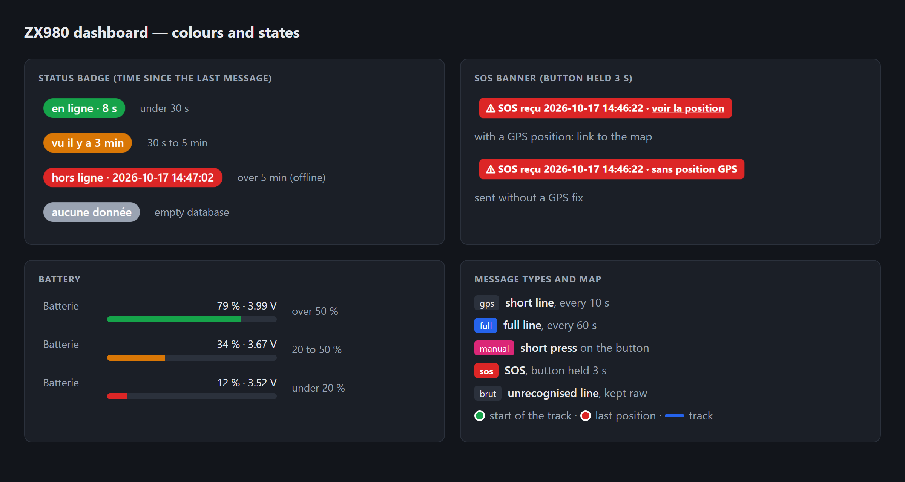

# ZX980 Server

FreeBSD server for the ZX980 tracker (Quectel EC800M module): receives the GPS lines sent by `ZX980/usr/gps_post.py` and shows them on a web dashboard.

Standard Python 3 only (no uvicorn, fastapi or nginx).


*Dashboard with demo data: a 2.4 km loop around the centre of Lisieux, last hour, dark theme. SOS banner and purge buttons in the header, trip, position and device cards on the left, track on the map (green dot = start), messages of the period below with every message type (gps, full, manual, sos, brut).*



*Every colour the dashboard uses: status badge, SOS banner with or without a GPS position, battery level, message types and map markers. The interface itself is in French.*

## How it works

| Port | Role | Exposure |
|------|------|------------|
| 8080 | `POST /message` `{"texte": "..."}` sent by the tracker | forwarded on the router (internet) |
| 8090 | web dashboard + JSON API, protected by username / password | local network only |

Two line formats are recognised:

- short (every 3 s by default, `gps_interval_s` in the tracker `config.json`): `date,lon,lat,alt,speed,`
- full (every 60 s): `date,battery,fix,lon,lat,alt,speed,ip,operator,network,phone,satellites,`. The older format without `satellites` (11 fields) is still accepted.
- SOS (double click on the tracker button): `SOS,` followed by a full line. Without GPS fix the position fields are `?`. Stored with kind `sos`, shown with a red tag in the table, and the latest SOS of the period is shown as a red banner in the header, with a link to its position when there is one. Its × button hides that SOS in this browser (remembered across reloads); a newer SOS shows the banner again.
- Manual send (short press on the tracker button): `MANUAL,` followed by a full line. Stored with kind `manual` and shown with a pink tag in the table. Manual and SOS lines also update the Appareil (device) card.

The satellites field looks like `7/12(BD4+GP8)`: 7 used, 12 in view, of which 4 BeiDou and 8 GPS. It is stored as is in the `satellites` column, which is added automatically to existing databases at startup. It is shown in the Appareil (device) card (used / in view, then in view per constellation: GPS, BeiDou…) and in the Satellites column of the table.

The battery field looks like `100%(4165mV)`: the percentage goes into the `battery` column, the voltage into `battery_mv` (added and filled from the raw lines at startup for existing databases). Both are shown (`100 % · 4.17 V`).

Messages are stored in SQLite (`/var/db/zx980/zx980.sqlite`). Unrecognised lines are kept raw.

Dashboard (`http://<ip>:8090/`, refreshed every 5 s, interface in French): online / offline status, OpenStreetMap map with the track (1 h to 7 days, or the « du / au » (from / to) fields + Afficher), trip distance and max speed, position, battery, fix, network, operator, IP, phone, messages of the period, CSV export of the period (`/api/export.csv`).

Raw data: `/api/state?hours=24` or `/api/state?from=2026-10-16T08:00&to=2026-10-16T18:00` (server time, time of reception; the page converts to and from the browser's time, which matters when FreeBSD runs in UTC). The distance only counts segments at 2 km/h or more, to ignore GPS noise while stationary.

### Trips and stops in the message table

With **Regrouper** (group) ticked, the default, the message table shows the whole period as folded segments, newest first:

- **Trajet** (trip): start → end, duration, distance, max speed, number of messages, battery at the end.
- **Arrêt** (stop): start → end, duration, number of messages, battery.
- A dashed line « Aucun message pendant … » marks a gap of more than 5 min without messages (tracker off, no GPS fix, no network).

A trip starts after 2 messages in a row at 2 km/h or more, and ends after 60 s below that speed, so a traffic light does not split it. SOS, manual and raw messages always stay visible under their segment header, with a tag in the header. Click a header to unfold all the messages of the segment (loaded on demand, up to 5,000; `/api/messages?first=<id>&last=<id>`); it stays unfolded across the 5 s refreshes. The last unfolded segment is also shown on the map and the map zooms to it: a trip as a thick orange line, a stop as an orange ring; its header gets an orange edge and « sur la carte » (on the map). Folding it removes it from the map. Untick **Regrouper** for the flat list of the 500 latest messages; the choice is remembered in the browser.

The segments are computed by the server over the whole period (`groups` in `/api/state`), not only over the 500 messages of the flat list.

### Purging data

Two red buttons in the header delete messages for good:

- **Purger la période** (purge the period): deletes the messages of the period currently displayed (1 h to 7 days, or the « du / au » dates). A confirmation shows the number of messages and the exact dates first.
- **Tout purger** (purge everything): deletes every message in the database. It asks for a confirmation, then for the word `SUPPRIMER` to be typed.

After each purge the database is compacted (`VACUUM`), so the deleted positions do not remain in the SQLite file. Each purge is logged (`Purge par <ip> : N message(s) supprimé(s)`).

API: `POST /api/purge?from=...&to=...` (or `?hours=N`) or `POST /api/purge?all=1`, with the dashboard credentials and the `X-ZX980: purge` header. The header is required so that another website cannot trigger a purge through the browser's saved credentials. Answer: `{"deleted": N}`.

## Installation (FreeBSD, as root)

```sh
pkg install python312 py312-sqlite3
install -m 555 zx980_server.py /usr/local/libexec/zx980_server.py
install -m 555 zx980.rc /usr/local/etc/rc.d/zx980
sysrc zx980_enable=YES
python3.12 /usr/local/libexec/zx980_server.py --auth-file /usr/local/etc/zx980.users --add-user admin
service zx980 start
tail -f /var/log/zx980.log
```

## Updating

Download the script straight from GitHub rather than copy-pasting it (a truncated file makes the service restart in a loop, and Caddy then answers 502 Bad Gateway):

```sh
fetch -o /tmp/zx980_server.py https://raw.githubusercontent.com/k-vanier/DEV/main/ZX980_Server/zx980_server.py
install -m 555 /tmp/zx980_server.py /usr/local/libexec/zx980_server.py
python3.12 -m py_compile /usr/local/libexec/zx980_server.py && service zx980 restart
tail -3 /var/log/zx980.log
```

`py_compile` prints nothing when the file is valid; on an error the service is not restarted and the running version keeps working. The log must show `Tableau de bord sur http://...`. Then reload the dashboard with Ctrl+F5.

The same goes for `zx980.rc` (`.../ZX980_Server/zx980.rc` to `/usr/local/etc/rc.d/zx980`) and the `Caddyfile`, which only needs `service caddy reload` (keep your own domain name in the installed copy).

The database (`/var/db/zx980/zx980.sqlite`) is kept across updates; new columns are added automatically at startup.

## Dashboard access

The dashboard (page, `/api/state`, CSV export) asks for a username and password (HTTP Basic authentication). The tracker's port 8080 is not affected.

- Accounts are in `/usr/local/etc/zx980.users`, one `name:hash` line per user (PBKDF2-SHA256, never the clear-text password).
- Add an account or change a password (8 characters minimum):
  ```sh
  python3.12 /usr/local/libexec/zx980_server.py --auth-file /usr/local/etc/zx980.users --add-user NAME
  ```
  The server re-reads the file whenever it changes, no restart needed. For the **first** account, run `service zx980 restart`: startup gives the `www` group read access to the file (640).
- Remove an account: delete its line from the file.
- If the file is missing, the dashboard is locked (everything is refused).
- `sysrc zx980_authfile=""` disables the password.

Without HTTPS the password travels in clear text (base64) on the local network. Do not open port 8090 to the internet: use HTTPS with Caddy (below) instead.

## HTTPS with Caddy

[Caddy](https://caddyserver.com) sits in front of the dashboard: it answers in HTTPS on port 443 with a Let's Encrypt certificate that it obtains and renews on its own, and passes the requests to `zx980_server.py`, which then only listens on `127.0.0.1:8090`. The password and the positions are encrypted, so the dashboard and the Android app can be used from outside (4G) without a VPN.

```
browser / Android app ──HTTPS :443──▶ Caddy ──HTTP 127.0.0.1:8090──▶ zx980_server.py
tracker ──────────────────HTTP :8080─────────────────────────────▶ zx980_server.py (unchanged)
```

Requirements:

- **A domain name pointing to the router's public IP.** On a Freebox, Freebox OS can create a free `<name>.freeboxos.fr` (domain name settings). Any other domain with an A record works too.
- **Ports 443 and 80 forwarded to the FreeBSD machine** on the router. 443 is enough for Let's Encrypt (TLS-ALPN challenge); 80 also lets Caddy redirect `http://` to `https://`. Check that the router's own remote access does not already use port 443 (on a Freebox: the remote access settings of Freebox OS).

Installation (as root):

1. Install Caddy:
   ```sh
   pkg install caddy
   ```
2. Copy [`Caddyfile`](Caddyfile) to `/usr/local/etc/caddy/Caddyfile`, then replace `tracker.example.com` with your domain name (and optionally set `email`). Check it:
   ```sh
   caddy validate --config /usr/local/etc/caddy/Caddyfile
   ```
3. Start Caddy and enable it at boot:
   ```sh
   sysrc caddy_enable=YES
   service caddy start
   ```
4. Make the dashboard listen on the local loopback only, so it cannot be reached without HTTPS (keep any other options you already had in `zx980_args`):
   ```sh
   sysrc zx980_args="--web-host 127.0.0.1"
   service zx980 restart
   ```
5. Open `https://<your domain>/` (no port). The first certificate takes a few seconds; `service caddy status` and `/var/log/messages` show errors if it fails. In the Android app, change the dashboard address to `https://<your domain>`.

Notes:

- The tracker keeps sending to port 8080 in plain HTTP; Caddy does not touch it.
- After step 4, `http://<ip>:8090` no longer answers on the local network: use `https://<your domain>/` at home too (the Freebox routes it back to the server).
- Behind Caddy, the server logs the visitor's real address (from `X-Forwarded-For`) for failed logins and purges, instead of `127.0.0.1`.
- `Strict-Transport-Security` in the Caddyfile makes browsers refuse plain HTTP for this domain for one year: remove that line while testing if you might go back.

## Configuration (`sysrc`)

| Variable | Default |
|----------|--------|
| `zx980_runas` | `www` |
| `zx980_python` | `/usr/local/bin/python3.12` |
| `zx980_script` | `/usr/local/libexec/zx980_server.py` |
| `zx980_dbdir` | `/var/db/zx980` |
| `zx980_logfile` | `/var/log/zx980.log` |
| `zx980_authfile` | `/usr/local/etc/zx980.users` (`""` = no password) |
| `zx980_args` | (empty), e.g. `--api-port 8080 --web-port 8090 -v`, or `--web-host 127.0.0.1` behind Caddy |

Do not use `zx980_user`: rc.subr would then run `daemon(8)` itself as that user, which can no longer write its pid files.

The service is supervised by `daemon(8)` and restarts automatically after 5 s if it stops.

## Manual run (testing)

```sh
python3.12 zx980_server.py --db ./zx980.sqlite --api-port 18080 --web-port 18090 -v
```
