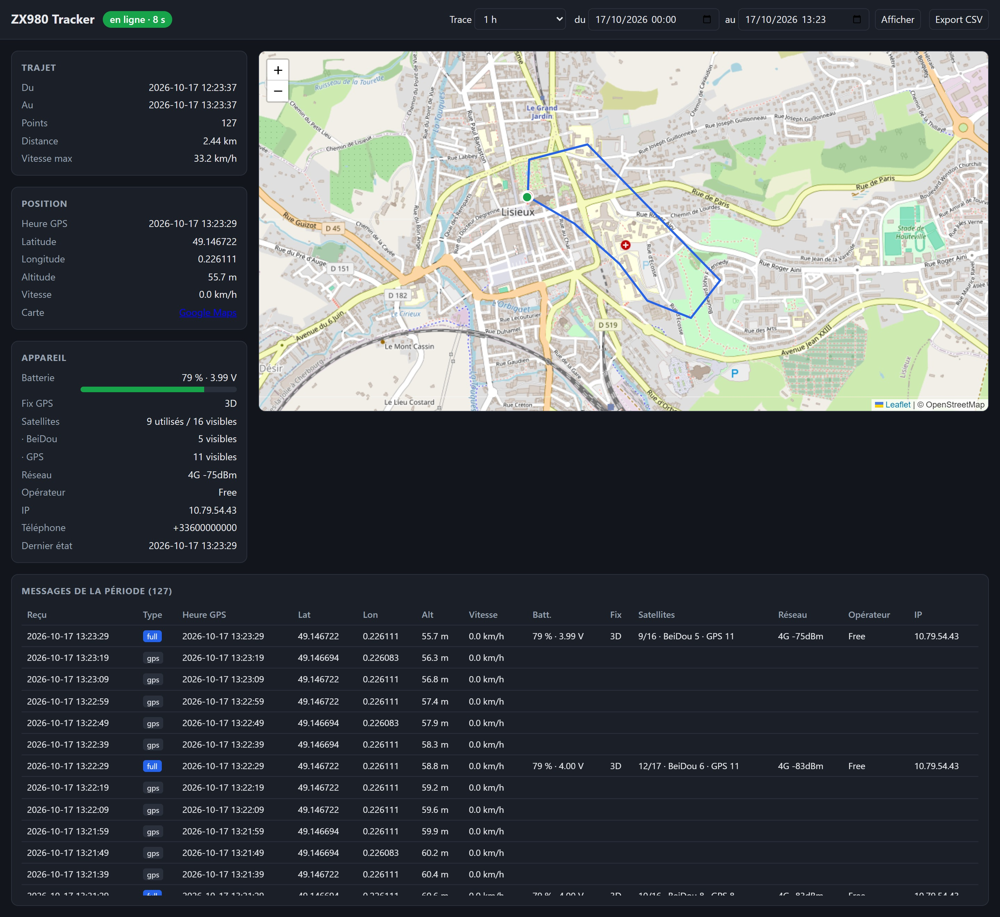

# ZX980 Server

FreeBSD server for the ZX980 tracker (Quectel EC800M module): receives the GPS lines sent by `ZX980/usr/gps_post.py` and shows them on a web dashboard.

Standard Python 3 only (no uvicorn, fastapi or nginx).



*Dashboard with demo data: a 2.4 km loop around the centre of Lisieux, last hour, dark theme. Trip, position and device cards on the left, track on the map (green dot = start), messages of the period below.*

## How it works

| Port | Role | Exposure |
|------|------|------------|
| 8080 | `POST /message` `{"texte": "..."}` sent by the tracker | forwarded on the router (internet) |
| 8090 | web dashboard + JSON API, protected by username / password | local network only |

Two line formats are recognised:

- short (every 10 s): `date,lon,lat,alt,speed,`
- full (every 60 s): `date,battery,fix,lon,lat,alt,speed,ip,operator,network,phone,satellites,`. The older format without `satellites` (11 fields) is still accepted.
- SOS (button held 3 s on the tracker): `SOS,` followed by a full line. Without GPS fix the position fields are `?`. Stored with kind `sos`, shown with a red tag in the table, and the latest SOS of the period is shown as a red banner in the header, with a link to its position when there is one.

The satellites field looks like `7/12(BD4+GP8)`: 7 used, 12 in view, of which 4 BeiDou and 8 GPS. It is stored as is in the `satellites` column, which is added automatically to existing databases at startup. It is shown in the Appareil (device) card (used / in view, then in view per constellation: GPS, BeiDou…) and in the Satellites column of the table.

The battery field looks like `100%(4165mV)`: the percentage goes into the `battery` column, the voltage into `battery_mv` (added and filled from the raw lines at startup for existing databases). Both are shown (`100 % · 4.17 V`).

Messages are stored in SQLite (`/var/db/zx980/zx980.sqlite`). Unrecognised lines are kept raw.

Dashboard (`http://<ip>:8090/`, refreshed every 5 s, interface in French): online / offline status, OpenStreetMap map with the track (1 h to 7 days, or the « du / au » (from / to) fields + Afficher), trip distance and max speed, position, battery, fix, network, operator, IP, phone, messages of the period, CSV export of the period (`/api/export.csv`).

Raw data: `/api/state?hours=24` or `/api/state?from=2026-10-16T08:00&to=2026-10-16T18:00` (server time, time of reception; the page converts to and from the browser's time, which matters when FreeBSD runs in UTC). The distance only counts segments at 2 km/h or more, to ignore GPS noise while stationary.

### Purging data

Two red buttons in the header delete messages for good:

- **Purger la période** (purge the period): deletes the messages of the period currently displayed (1 h to 7 days, or the « du / au » dates). A confirmation shows the number of messages and the exact dates first.
- **Tout purger** (purge everything): deletes every message in the database. It asks for a confirmation, then for the word `SUPPRIMER` to be typed.

After each purge the database is compacted (`VACUUM`), so the deleted positions do not remain in the SQLite file. Each purge is logged (`Purge par <ip> : N message(s) supprimé(s)`).

API: `POST /api/purge?from=...&to=...` (or `?hours=N`) or `POST /api/purge?all=1`, with the dashboard credentials and the `X-ZX980: purge` header. The header is required so that another website cannot trigger a purge through the browser's saved credentials. Answer: `{"deleted": N}`.

## Installation (FreeBSD, as root)

```sh
pkg install python312 py312-sqlite3
install -m 555 zx980_server.py /usr/local/libexec/zx980_server.py
install -m 555 zx980.rc /usr/local/etc/rc.d/zx980
sysrc zx980_enable=YES
python3.12 /usr/local/libexec/zx980_server.py --auth-file /usr/local/etc/zx980.users --add-user admin
service zx980 start
tail -f /var/log/zx980.log
```

## Dashboard access

The dashboard (page, `/api/state`, CSV export) asks for a username and password (HTTP Basic authentication). The tracker's port 8080 is not affected.

- Accounts are in `/usr/local/etc/zx980.users`, one `name:hash` line per user (PBKDF2-SHA256, never the clear-text password).
- Add an account or change a password (8 characters minimum):
  ```sh
  python3.12 /usr/local/libexec/zx980_server.py --auth-file /usr/local/etc/zx980.users --add-user NAME
  ```
  The server re-reads the file whenever it changes, no restart needed. For the **first** account, run `service zx980 restart`: startup gives the `www` group read access to the file (640).
- Remove an account: delete its line from the file.
- If the file is missing, the dashboard is locked (everything is refused).
- `sysrc zx980_authfile=""` disables the password.

The password travels in clear text (base64) on the local network, because the server uses HTTP. Do not open port 8090 to the internet.

## Configuration (`sysrc`)

| Variable | Default |
|----------|--------|
| `zx980_runas` | `www` |
| `zx980_python` | `/usr/local/bin/python3.12` |
| `zx980_script` | `/usr/local/libexec/zx980_server.py` |
| `zx980_dbdir` | `/var/db/zx980` |
| `zx980_logfile` | `/var/log/zx980.log` |
| `zx980_authfile` | `/usr/local/etc/zx980.users` (`""` = no password) |
| `zx980_args` | (empty), e.g. `--api-port 8080 --web-port 8090 -v` |

Do not use `zx980_user`: rc.subr would then run `daemon(8)` itself as that user, which can no longer write its pid files.

The service is supervised by `daemon(8)` and restarts automatically after 5 s if it stops.

## Manual run (testing)

```sh
python3.12 zx980_server.py --db ./zx980.sqlite --api-port 18080 --web-port 18090 -v
```
